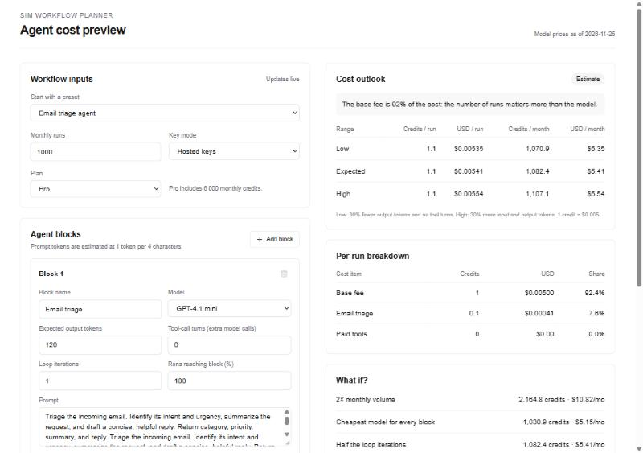
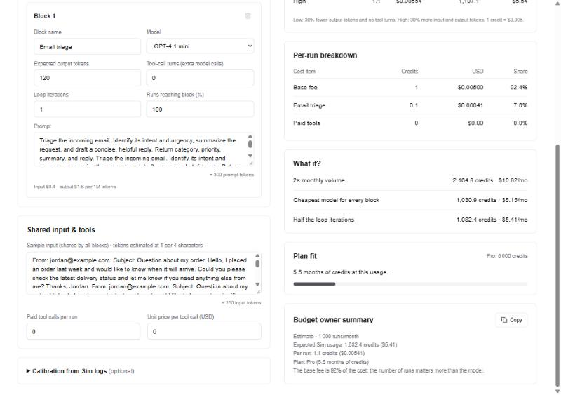
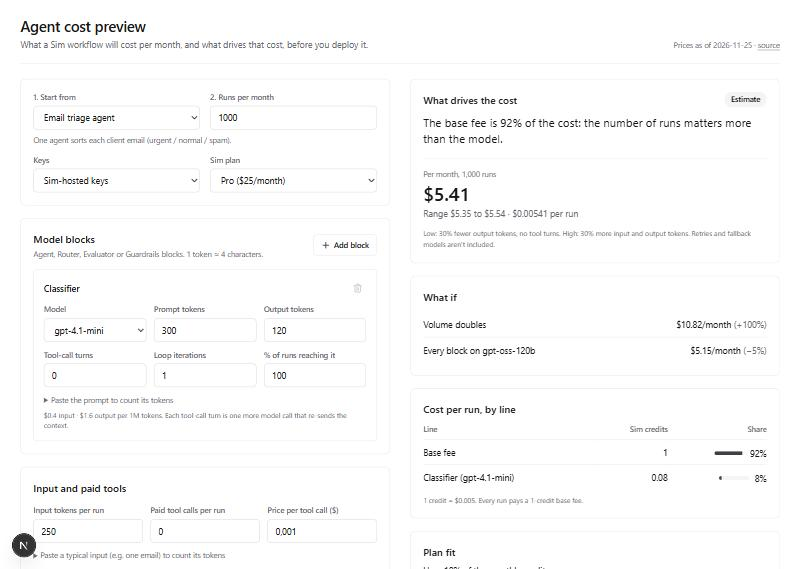

# E. Build the prototype

Status: validated · [Back to the method](../README.md)

**Goal:** a working cost estimator, built from the [V2 spec](../D-stress-test-the-idea/).

**Result:** [prototype/](../../prototype/), a single-page Next.js app. Run it with `npm install` then `npm run dev`.

## How it was built

| Step | Tool | What happened |
|---|---|---|
| 1. First draft | v0 | Generated the page layout and a first version of the logic from a one-page brief |
| 2. Review | Claude Code | v0's calculation had two bugs: in BYOK mode, the monthly dollar total left out the provider bill, and calibration replaced every block's tokens with the same numbers, which breaks workflows with several blocks |
| 3. Logic rewritten | Claude Code | Pure functions in `lib/`, separate from the page, with 11 tests against the worked examples of steps A and D |
| 4. Page rewired | Claude Code | Kept v0's layout, reordered the results as V2 asks (driver first), removed unused dependencies, added the JSON import |

## The v0 draft vs the final version

- **v0 chat:** [v0.app/chat/tul24CKwLZH](https://v0.app/chat/tul24CKwLZH) (private: opens only for the account that created it). Its live preview link expires after a few hours, so the screenshots below are the record.
- **Final version:** runs locally from [prototype/](../../prototype/); a public link comes in step G (Vercel).

**v0 draft** (prices, presets and layout from the brief; results start with a table of credits)

**Final version** (same layout; results start with what drives the cost, then the monthly figure and its range)

| | v0 draft | Final version |
|---|---|---|
| First thing in the results | A table of credits and dollars (low / expected / high) | The driver sentence, then one monthly figure with its range |
| BYOK monthly total | Leaves out the provider bill | Two bills, Sim credits and provider dollars, shown together |
| Calibration | Same token counts given to every block | Real tokens spread across blocks in proportion |
| "Half the loop iterations" | Shown even with no loop | Only shown when there is a loop |
| Workflow export import | Missing | Optional JSON import |
| Tests | None | 11 |

## What the page does

**3 actions:** 1. pick a preset or describe the blocks → 2. enter runs per month → 3. read and copy the summary.

| Output (spec C and D) | In the prototype |
|---|---|
| Biggest driver, first | "The base fee is 92% of the cost: the number of runs matters more than the model." |
| Cost per month and per run, with a range | Expected figure, low and high, and what causes the range |
| Estimate vs calibrated | Badge; paste the real tokens of one run to switch to "Calibrated" (range narrows to ±10%) |
| What if | Volume doubles, every block on the cheapest model, loop iterations halved (only shown when there is a loop) |
| Breakdown by line | Base fee, each model block, paid tools, with share bars |
| BYOK | Two bills shown separately: Sim credits and the provider's dollars |
| Plan fit | Share of monthly credits used; on Free, a warning that hosted models don't run |
| Summary for the budget owner | Five lines with a Copy button |
| Dated prices | "Prices as of 2026-11-25" with a link to Sim's price table |
| Import a workflow export | Optional, reads blocks, models, prompts and loops from the JSON |

## Checks

| Case | Expected (steps A and D) | Prototype |
|---|---|---|
| Email agent, gpt-4.1-mini, 1,000 runs, hosted | 1.08 credits per run, ~$5.40 a month, base fee 92% | 1.082 credits, $5.41, 92% |
| Same agent on gpt-5.5 | 2.27 credits per run | 2.27 |
| Research agent, 1,000 runs | ~47 credits per run, ~$235 a month, base fee ~2% | 47 credits, $235, 2% |
| Research agent with BYOK | 1 base credit + tools in Sim, tokens to the provider | 3,000 Sim credits ($15) + $220 to the provider |
| Tool-call turns | Each turn re-sends the context | Tested: 2 turns on 500 in / 100 out = 1,800 input tokens |
| Free plan with hosted keys | Warning | Shown |

Tests: `npm test`, 11 passing. Type check and production build pass.

## Known limits

- **Workflow export:** the reader assumes the model and prompts sit in `subBlocks.<field>.value`. This is unconfirmed and tested only on a hand-made sample. To check with a real export in step F.
- **Retries and fallback models** aren't included (not documented by Sim).
- **Plans:** only the monthly credits are counted; the weekly allowance comes on top.
- **Prices** are a snapshot and need updating when Sim's table changes.
