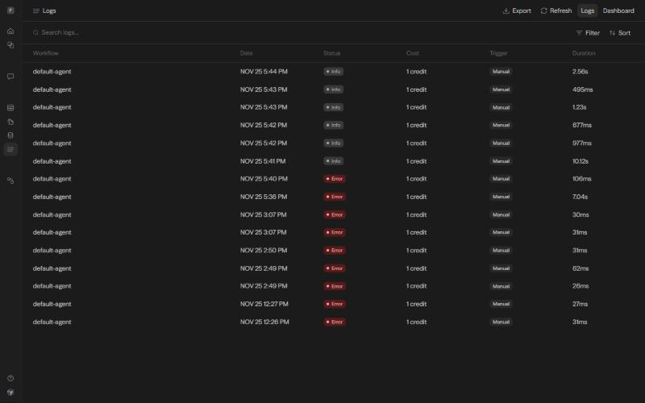

# F. Check it against reality

Status: validated · [Back to the method](../README.md)

**Goal:** check the estimate against real runs in Sim.

**In one line:** the estimator got **the total per run right (+4%)** and **Sim's bill exactly right**. It **overestimated the model's part by 120%**, because it guessed the answer length. Because the base fee dominates, that error barely moves the total.

## Setup

| | |
|---|---|
| Date | 2026-11-25 |
| Workflow | Start → one Agent block (the bank email classifier from [discovery](../../docs/01-discovery.md)) |
| Model | gemini-3.5-flash-lite ($0.30 input / $2.50 output per 1M tokens, from Sim's table) |
| Keys | Your own Google key (BYOK), Sim free plan |
| Inputs | 5 test emails of different lengths and categories; email 2 ran twice by accident, giving 6 runs |
| Data source | Sim's run logs: status, cost, input and output tokens, model answer |
| Estimate | The prototype's logic ([scripts/compare-real-runs.ts](../../prototype/scripts/compare-real-runs.ts)): prompt and email length ÷ 4, output guessed at 120 tokens |

Getting a run to work took three tries:
- OpenAI refused: the account had no API credit.
- Google refused gemini-2.5-flash-lite: no longer available to new users.
- gemini-3.5-flash-lite worked.

## Results

| Run | Email | Answer | Input tokens est. / real | Output tokens est. / real | Sim cost est. / real | Model cost est. / real (millionths of $) |
|---|---|---|---|---|---|---|
| 1 | Blocked card, short (133 chars) | Urgent ✓ | 98 / 91 (+8%) | 120 / 68 | 1 / 1 credit | 329 / 197 |
| 2a | Savings plan (460 chars) | Normal ✓ | 179 / 155 (+15%) | 120 / 23 | 1 / 1 | 354 / 104 |
| 2b | Same email, run again | Normal ✓ | 179 / 155 (+15%) | 120 / 28 | 1 / 1 | 354 / 117 |
| 3 | Fake cash bonus (262 chars) | Spam ✓ | 130 / 123 (+6%) | 120 / 22 | 1 / 1 | 339 / 92 |
| 4 | Mortgage request, long (1,375 chars) | Normal ✓ | 408 / 388 (+5%) | 120 / 29 | 1 / 1 | 422 / 189 |
| 5 | Card fraud (550 chars) | Urgent ✓ | 202 / 198 (+2%) | 120 / 90 | 1 / 1 | 361 / 284 |
| **Total** | | **6 / 6 correct** | **+8%** | **+177%** | **0%** | **+120%** |

**What a run really costs** (average of the 6):

| | Estimate | Real | Gap |
|---|---|---|---|
| Sim bill (base fee) | $0.00500 | $0.00500 | 0% |
| Google bill (tokens) | $0.00036 | $0.00016 | +120% |
| **Total per run** | **$0.00536** | **$0.00516** | **+4%** ✓ (target ±20%) |
| 1,000 emails a month | $5.36 | $5.16 | +4% |

## What this shows

1. **Sim's bill is fully predictable.** Every run cost exactly 1 credit. With your own key, Sim charges only the base fee, as [step A](../A-understand-how-sim-charges/) found in the docs.
2. **Characters ÷ 4 works for the input.** The input estimate was 2% to 15% high, +8% on average, well within ±20%. Real ratio: about 4.3 characters per token.
3. **The answer length is the weak point.** I guessed 120 output tokens; the real range was 22 to 90. Urgent emails get a 3-line summary (68 to 90 tokens), normal and spam emails don't (22 to 29). **Output depends on the branch the model takes**, so a single guess can't be right.
4. **Calibrating on one run isn't enough.** Calibrating on run 1 (urgent) and applying it to the others still overestimates the model cost by 47%, because the urgent run had the longest answer.
5. **The range was too narrow.** The real model cost fell inside the estimated low–high range in only 1 of 6 runs: the low end (output −30%) was still above the real answers.
6. **The total is right for the wrong reason.** For this small agent, the base fee is 97% of the cost. A 120% error on the model part moves the total by only 4%. On a large agent (the research preset, where the model is 94% of the cost), the same error would break the ±20% target.

## New product gaps found in Sim

| Gap | Evidence |
|---|---|
| **Failed runs are charged.** Each of the 9 failed runs cost 1 credit, including runs that failed in 30 ms because no key was set | Sim's logs (screenshot above) |
| **With your own key, Sim logs the model cost as $0.** The token cost goes to Google and appears nowhere in Sim | Run logs: model cost 0, pricing 0, while tokens are recorded |
| **No warning when a model is retired by the provider.** Sim still offers gemini-2.5-flash-lite; the run fails with Google's 404 | Run log error |

## Changes this calls for (V3)

| Change | Why |
|---|---|
| Output length per branch: ask "how long is the answer for each type of input?", or the share of inputs that get a long answer | Output varied from 22 to 90 tokens depending on the category |
| Calibrate on 3 to 5 runs (average), not one | One run gave a 47% error |
| Widen the low end of the range (output −70%) | 5 of 6 real runs fell below the current low end |
| Warn that failed runs are charged too | 9 failed runs cost 9 credits |
| Show the provider bill as "not visible in Sim's logs" | Sim records it as $0 |

## Limits of this check

- 6 runs, one model, one simple agent. Enough to see the pattern, not a statistical test.
- Tool-call turns, loops and the research preset weren't tested with real runs.
- The JSON import is still unchecked: the export API needs a Sim API key, which we didn't create.
- Test emails were written for the test, not real client emails.
