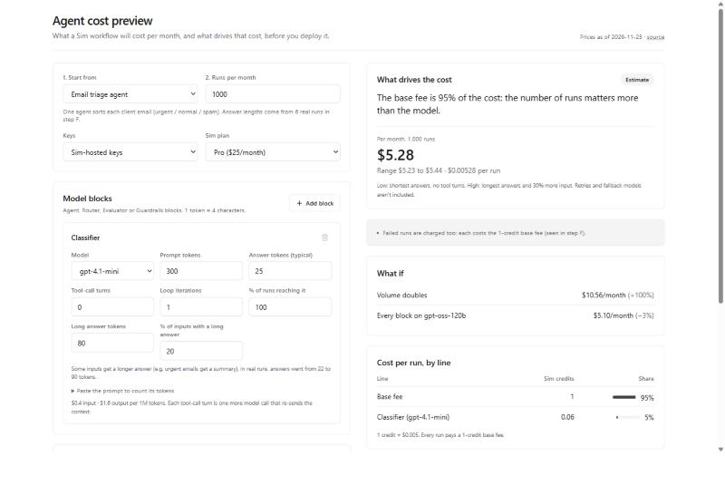

# G. Publish (final version)

Status: validated · [Back to the method](../README.md)

**Goal:** a final version anyone can open.

**Live page:** [costly-silk.vercel.app](https://costly-silk.vercel.app) (public, no account needed)

**Code:** [prototype/](../../prototype/)

## What the final version is (V3)

V3 is the V2 prototype from [step E](../E-build-the-prototype/) plus the fixes that the real runs of [step F](../F-check-it-against-reality/) called for. The layout is unchanged; the changes are in the cost logic.

| Change from step F | In the final version |
|---|---|
| Answer length depends on the branch the model takes (22 to 90 tokens) | Each block has a typical answer and a "long answer" with the share of inputs that get it. The email preset uses 25 tokens, and 80 tokens for 20% of emails |
| Calibrating on one run gave a 47% error | Paste 3 to 5 real runs, one per line. Their average replaces the estimate, and the range becomes the cheapest and the dearest run. With fewer than 3 runs, a warning |
| The low end of the range was too high (5 of 6 runs below it) | Without a long answer, the low end is now −70% on the answer |
| Failed runs are charged | Always shown as a note |
| With your own key, Sim logs the model cost as $0 | Shown as a note in BYOK mode |
| gemini-2.5-flash-lite is retired by Google | Removed from the model list; gemini-3.5-flash-lite added |

## Checks

| Check | Result |
|---|---|
| Unit tests (`npm test`) | 14 passing, including the step F data: total and answer length both within ±20% |
| Type check and production build | Pass |
| Email preset, 1,000 runs, gpt-4.1-mini, hosted keys | $5.28 a month, locally and on the live page |
| Calibrated on the 6 real runs of step F (gemini-3.5-flash-lite, BYOK) | $5.16 a month: 1,000 Sim credits ($5) + $0.16 to Google, same as the real runs |

## How it was published

| Step | What happened |
|---|---|
| 1 | Final code committed to the repository |
| 2 | Sent to v0 as files (no new generation: the code is the tested code, unchanged) |
| 3 | Published from v0 to Vercel, visibility "Public" |

The Vercel CLI wasn't installed, and publishing from the v0 API was refused (403), so the last click was done in v0's interface.

## Limits

- Prices are a snapshot dated 2026-11-25. They need updating when Sim's price table changes.
- The workflow export import is still unchecked against a real export (it needs a Sim API key).
- "Readable without Sim" (3 test readers, step C) is still to test.
