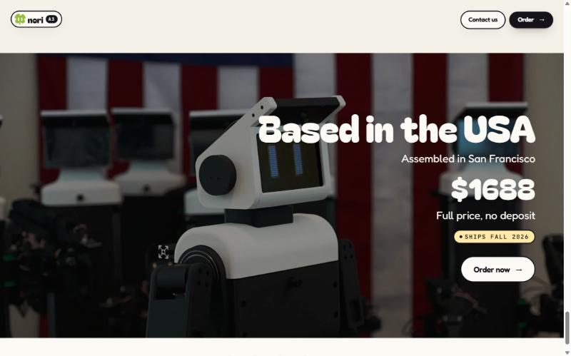
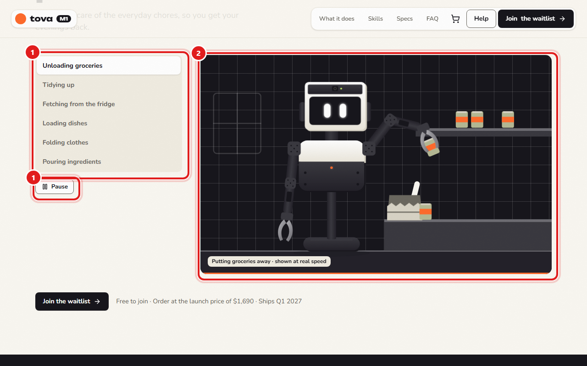
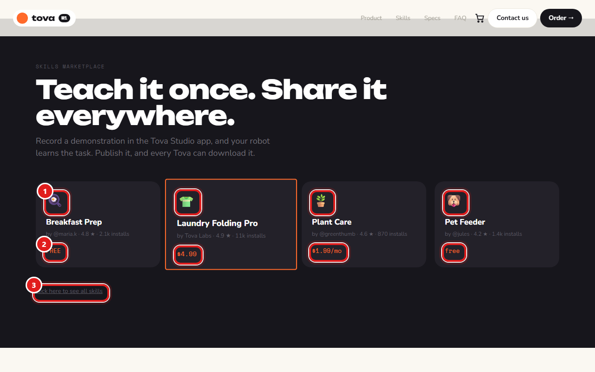
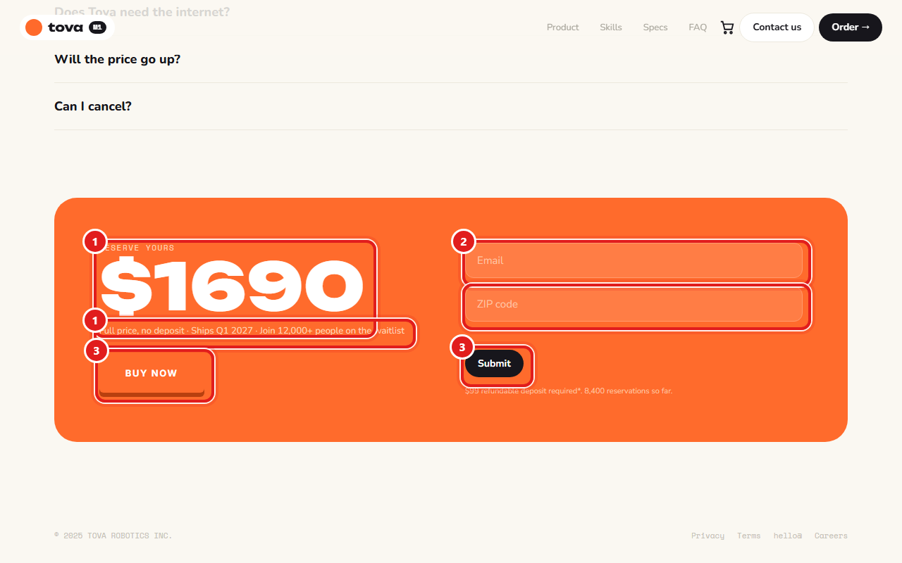
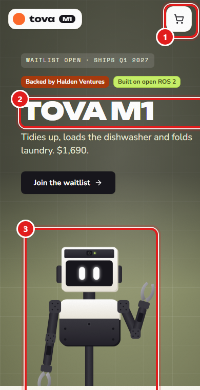
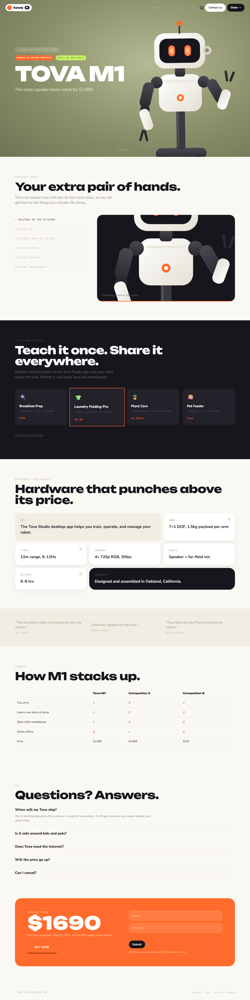
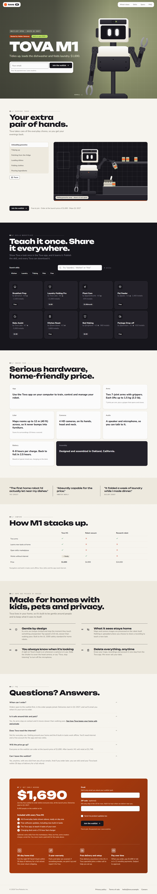
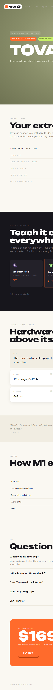
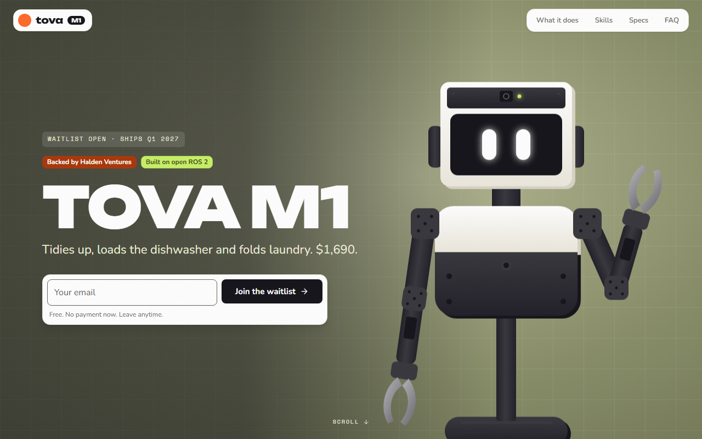
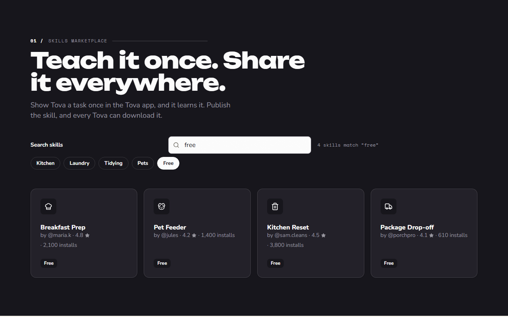

# Tova M1: from a broken landing page to a polished product page

A design practice project. **Tova M1** is a fictional home robot, with a landing page modelled on the real [Nori Robotics](https://www.norirobotics.com/) site (a Y Combinator company). I first built a deliberately broken version with planted design, copy and accessibility flaws. Then I fixed it step by step with Claude skills: critique, design system, accessibility, UX discovery, UX copy, interaction design, an expert panel and front-end art direction.

Tova is an original brand. It copies Nori's page structure, not its name, logo, colours, robot or copy.

**What's in this folder**

| Folder | Contents |
|---|---|
| [`report/`](report/) | The full before/after report: [HTML](report/tova-m1-report.html) (playable task animations) and [PDF](report/tova-m1-report.pdf) |
| [`screenshots/`](screenshots/) | Before/after pairs, full-page captures and the Nori reference |
| [`site-before/`](site-before/) | Code of the broken starting site |
| [`site-after/`](site-after/) | Code of the final site |
| [`skill-reports/`](skill-reports/) | The report written by each skill along the way |

> GitHub doesn't run HTML files. To read the report with its animations, download `report/tova-m1-report.html` and open it in a browser.

---

## 1. The reference: Nori Robotics

All screenshots come from **https://www.norirobotics.com/** and were taken on 12 November 2026, for reference only.

| Section | Link | Screenshot |
|---|---|---|
| Hero | [norirobotics.com](https://www.norirobotics.com/) | [nori-top.png](screenshots/nori/nori-top.png) |
| Everyday tasks | [norirobotics.com](https://www.norirobotics.com/) (scroll to "Everyday tasks") | [nori-tasks.png](screenshots/nori/nori-tasks.png) |
| Skills marketplace | [norirobotics.com](https://www.norirobotics.com/) (scroll to "Skills marketplace") | [nori-skills.png](screenshots/nori/nori-skills.png) |
| Specs | [norirobotics.com](https://www.norirobotics.com/) (scroll to "Affordable and capable") | [nori-specs.png](screenshots/nori/nori-specs.png) |
| Order band | [norirobotics.com](https://www.norirobotics.com/) (scroll to the order section) | [nori-order.png](screenshots/nori/nori-order.png) |


<p>
  
  
  
</p>

What Tova borrows from it:
- **Hero:** a big robot render on an olive background, the product name in a chunky display face, a monospace "now shipping" tag and two badges.
- **Everyday tasks:** clips of the robot at work, with a tab row and progress bars.
- **Skills marketplace**, then spec cards, then a full-width order band with the price.

---

## 2. The steps

| # | Skill or request | What it changed |
|---|---|---|
| 0 | Reference | The real Nori Robotics site: the genre and layout being imitated. |
| 1 | Request, no skill | Built "Tova M1": an original fictional brand on the same kind of page, with planted design, copy and accessibility flaws. |
| 2 | `/design-critique` | Structured critique of hierarchy, usability and consistency ([report](skill-reports/01-design-critique.md)). |
| 3 | `/design-system` | Audit against the tokens and brand file, then a two-layer token system ([report](skill-reports/02-design-system-audit.md)). |
| 4 | `/accessibility-review` | WCAG 2.1 AA audit and fixes: contrast, labels, keyboard, focus, pause control ([report](skill-reports/03-accessibility-audit.md)). |
| 5 | `/ux-superpowers` | UX discovery: personas, jobs to be done, journey, telemetry plan ([report](skill-reports/04-ux-discovery.md)). |
| 6 | `/ux-copy` | New trust blocks, then a review of every string, applied in full ([report 1](skill-reports/05-ux-copy.md), [report 2](skill-reports/06-ux-copy-review.md)). |
| 7 | `/interaction-design` | Interactive hero robot: head tracking, blinking, privacy shutter, wake wave ([report](skill-reports/07-interaction-design.md)). |
| 8 | `/debatexperts` | Expert panel on the robot, then the V2 was built ([report](skill-reports/08-expert-panel.md)). |
| 9 | Request, no skill | shadcn/ui components and Lucide icons. |
| 10 | Request, no skill | Robot redrawn to match a product render, keeping every effect. |
| 11 | `/frontend-design` | "Product spec sheet" art direction: paper grain, blueprint grid, numbered sections, motion. |
| 12 | Request, no skill | Skill search instead of a dead button, and six animated task scenes. |
| 13 | `/doc` | The before/after report in [`report/`](report/). |

---

## 3. Before vs after

Red boxes in the screenshots mark what changed. The numbers match the bullet points.

### Hero: one clear action and a robot that reacts

1. **One call to action:** "Contact us" and "Order →" competed in the header. The hero now has a single "Join the waitlist" button.
2. **Says what it does:** "The most capable home robot" became "Tidies up, loads the dishwasher and folds laundry. $1,690."
3. **No contradiction:** "now shipping fall 2026" clashed with "Ships Q1 2027" further down. It now reads "Waitlist open · Ships Q1 2027".
4. **Interactive robot:** the flat image became a robot that turns its head toward the pointer, blinks, and closes a privacy shutter when clicked.
5. **Honest cookie banner:** "By continuing to browse you agree" with a tiny "reject" link became a card with equal "Essential only" and "Accept all" buttons.

| Before | After |
|---|---|
|  |  |

### Everyday tasks: real tabs and animated scenes

1. **Accessible tabs you can pause:** the list was faint text that advanced on its own and couldn't be stopped. Now they are real tabs (arrow keys work) with a Pause button.
2. **A scene for each task:** every tab showed the same cropped image, and "Folding clothes" pointed to a missing file. Each task now plays its own 8-second animation, drawn in code with the hero robot's shapes and colours.

| Before | After |
|---|---|
|  |  |

### Skills marketplace: consistent cards and a working search

1. **Icons, not emoji:** emoji were replaced with Lucide icons.
2. **One price format:** "FREE", "free", "$1.99/mo" became consistent badges: "Free", "$4.99", "$1.99/month".
3. **Search instead of a dead link:** "click here to see all skills" led nowhere. A search field now filters the cards as you type, with a result count and an empty state.

| Before | After |
|---|---|
|  |  |

### Order band: a free waitlist with clear errors

1. **Consistent facts:** "Full price, no deposit" sat next to "$99 refundable deposit required", and "12,000+ people" next to "8,400 reservations". The offer is now one free waitlist, at $1,690, shipping Q1 2027.
2. **Labels and helpful errors:** the fields had only placeholders. They now have labels, hints and specific error messages.
3. **One clear button:** "Buy now" and "Submit" became a single "Join the waitlist", with a loading state and a confirmation dialog.

| Before | After |
|---|---|
|  |  |

### On a phone (390 px)

1. **Header fits:** the nav links overflowed the screen.
2. **Title fits:** "TOVA M1" was cut off at the right edge.
3. **The robot is visible:** it was pushed off-screen. It now sits under the button and still reacts to taps.

| Before | After |
|---|---|
|  |  |

### The whole page

Full pages, top to bottom, with no annotations.

| Before (desktop) | After (desktop) |
|---|---|
|  |  |

| Before (mobile) | After (mobile) |
|---|---|
|  |  |

---

## 4. Fewer clicks

A later pass, after the report: list every path through the page, count the clicks, and cut them. The report and the before/after screenshots above show the page before this pass.

| Path | Before | After | What changed |
|---|---|---|---|
| **Join the waitlist** (main goal) | 4 clicks + scroll to the bottom | **2 clicks**, no scroll | Email field directly in the hero. ZIP is optional and only in the bottom form. The confirmation shows in place, with no dialog to close. |
| Come back after joining | Every button still says "Join" | **0** | The page remembers you joined, and the buttons say "On the list". |
| Cookie banner | 1 click on every visit | 1 click, once | The choice is remembered. The dead "Cookie settings" link is gone. |
| Cart | 2 clicks to an empty cart | **Removed** | Nothing can be bought yet, so it was a dead end. |
| "Help" and "FAQ" | 2 buttons, same target | **1** | "Help" removed. |
| Read an FAQ answer | 2 clicks | **1** | All answers open by default. |
| Spec details | Hover or click on an ⓘ | **0** | The detail sits under each spec. |
| Filter skills | Click + type | **1 click** | Quick filters: Kitchen, Laundry, Tidying, Pets, Free. |

Code changes in the same pass:
- The header no longer measures the page on every scroll event. An `IntersectionObserver` tells it when the hero leaves the screen.
- No more dialogs: about 40 lines of code removed.
- The fake loading time after "Join" went from 1.8 s to 0.7 s.
- The page only stores "joined: yes" and the cookie choice, never the email address.

Trade-off: the ZIP code is no longer required, so fewer people will give it, but nobody is blocked on the main path. It can be asked for in the confirmation email.

| Quick join in the hero | One-click skill filters |
|---|---|
|  |  |

---

## 5. Where it stands

- **Works:** one design system (tokens, shadcn/ui components, Lucide icons), WCAG AA contrast and keyboard support, an interactive hero robot, six task animations with Pause, a searchable skills marketplace with quick filters, and a 2-click waitlist with errors, loading and an inline confirmation.
- **Still to do:** in the skill cards the "· installs" part can wrap onto its own line; the four extra skills are made up for the search demo; dark mode is planned but not built.
- The waitlist form is a demo: nothing is sent or saved.

## Run it locally

Plain HTML, CSS and JavaScript, with no build step. Serve either site folder with any static server, for example:

```bash
npx serve tova-m1-redesign/site-after
```

Then open the address it prints. Fonts load from Google Fonts.
